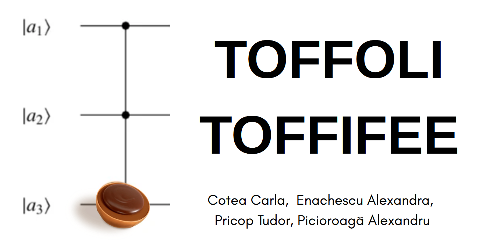
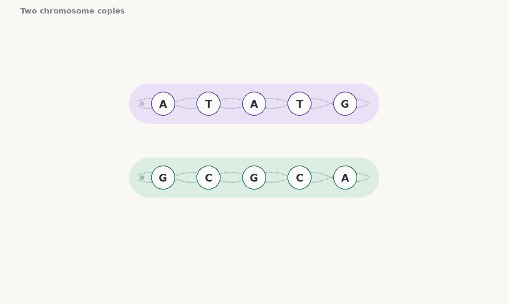
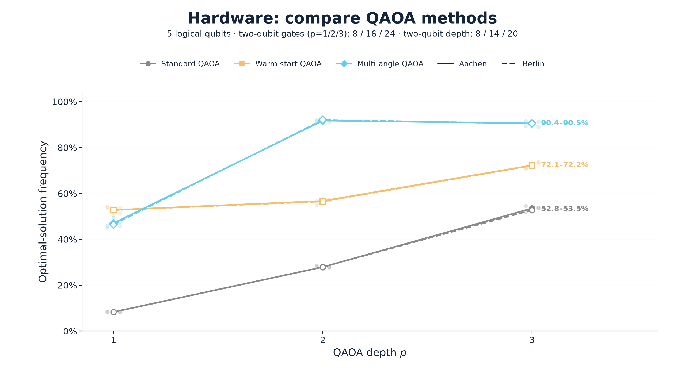
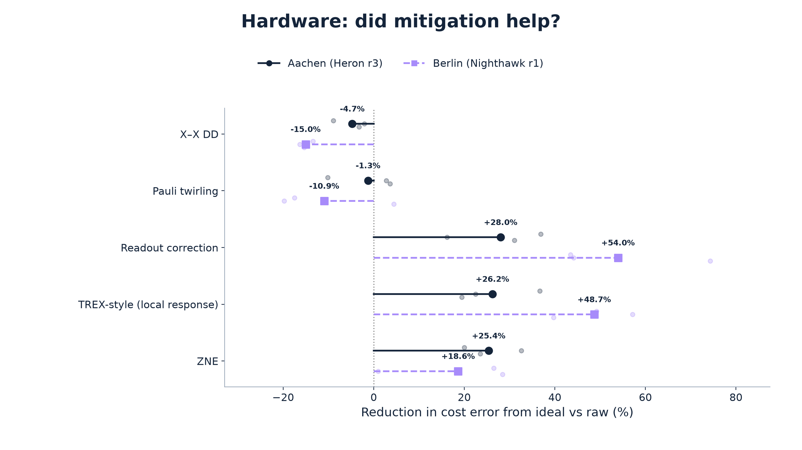
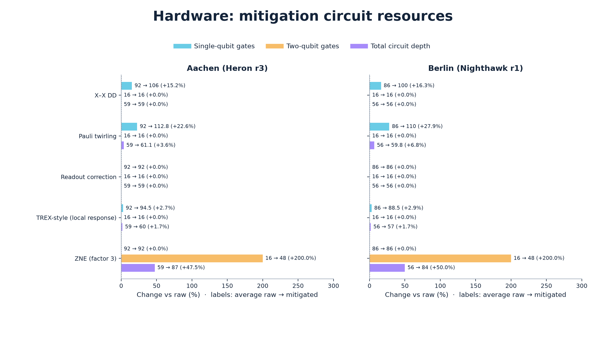

# Quantum Genome Detectives

**First place · Advanced Track · Qiskit Fall Fest 2026, Iași**

How can a quantum circuit help determine which DNA variants belong together?
This project explores that question through a small genome phasing problem,
classical search, and the Quantum Approximate Optimization Algorithm (QAOA).

We built it for the [Qiskit Fall Fest 2026 hackathon](https://www.freeya-mind-campus.ro/events-2026-iasi-cluj-timisoara-qiskit-fall-fest.html),
organized by FreeYa Mind Campus in Iași in collaboration with IBM Quantum.

[Presentation (PDF)](Quantum_Genome_Detective_Lab.pdf) ·
[Research investigation](INVESTIGATION.md)



## The challenge

We have two copies of a chromosome, but sequencing gives us short, incomplete
**reads** without telling us which copy each read came from. A **SNP** is a
position where a single DNA letter can vary; an **allele** is one version of
that letter. The task is to group the observed alleles into two sequences, or
**haplotypes**. This assignment is called *phasing*.

The supplied example has nine reads across five SNPs. A `0` or `1` labels an
allele; `-1` means the read does not cover that position. For example,
`[0, 1, 1, -1, -1]` says the observed alleles at SNPs 1 and 2 differ, while
those at SNPs 2 and 3 match. Reads can disagree, so we build a weighted graph
of these relationships and search for an assignment with the fewest pairwise
contradictions. For each pair, `A` counts reads with matching alleles and `D`
counts reads with different alleles. The animation uses illustrative DNA
letters and starts with a hypothetical chromosome pair matching the toy
model's optimum; the actual input contains binary labels, not DNA sequences or
known read origins.

In this example every site has one `0` and one `1` across the two copies, so
the second haplotype is the complement of the first. Exact enumeration gives
`01101` and `10010` as the two minimum-cost bitstrings, with a pairwise cost of
**1**. They describe the same phasing with the copy labels swapped.

For the circuit, we reduce the graph to a maximum-weight spanning forest,
preserving its connectivity while using fewer interactions. QAOA alternates
cost and mixing steps in a quantum circuit while a classical optimizer tunes
its angles to favor low-cost answers. Because pruning can change the optimum,
we score sampled candidates against the **full**, unpruned objective.

The animation shows one layer of three variants: standard QAOA shares its
angles, warm-start uses a classical candidate to bias the initial state and
mixer, and multi-angle uses separate angles for each interaction and qubit. We
also investigate classical methods, alternative objectives, and noise
mitigation. See the [visual challenge guide](docs/CHALLENGE_EXPLAINED.html) for
a step-by-step explanation; download or clone the repository and open the HTML
file in a browser to use the interactive guide.



## Results on IBM quantum hardware

For the five-SNP example, we compared the three QAOA methods at depths 1–3 on
`ibm_berlin` and `ibm_aachen`. The figure shows the raw frequency of sampling
either exact full-model minimum. The lines show means over three repeats; the
faint dots show the individual repeats, with 2,048 shots per circuit each.



At depth 2, multi-angle QAOA reached **92.0% on Berlin** and **91.7% on
Aachen**, compared with 27.9% on both devices for standard QAOA and 56.5% /
56.7% for warm-start. Multi-angle at depth 3 was slightly lower while using
24 two-qubit gates instead of 16.

### Noise mitigation and its cost

For the depth-2 multi-angle circuit, we also tested five noise-suppression and
mitigation techniques. Each technique and its matching raw reference had a
4,096-shot total budget per repeat. The plot shows the reduction in absolute
mean-cost error relative to that reference; points to the right of zero are
closer to the ideal estimate. Large points are means over three repeats.



Readout correction reduced the estimated cost error on both devices in this
pilot. It corrects an aggregate cost estimate, not the individual measured
bitstrings or their optimum frequency.

The techniques also have different circuit costs. For example, the factor-3
circuit used for zero-noise extrapolation has 48 two-qubit gates, compared
with 16 in its raw reference. The plot compares target circuits and excludes
calibration circuits; scheduled delays contribute to circuit depth.



## Find your way around

| Path | What you will find |
| --- | --- |
| [all_together.ipynb](all_together.ipynb) | Start here: the self-contained team notebook, from reads and objectives to classical search, QAOA, simulation, and checks. |
| [backend_comparison.ipynb](backend_comparison.ipynb) | The backend study: load a saved run or configure a new comparison. |
| [Presentation (PDF)](Quantum_Genome_Detective_Lab.pdf) | The slides our team presented at the hackathon. |
| [INVESTIGATION.md](INVESTIGATION.md) | The research question, results, limitations, and links to the underlying evidence. |
| [experiments/bench/](experiments/bench/) | Classical-versus-quantum benchmarks, shared adapters, and a plug-in template. |
| [experiments/objectives/](experiments/objectives/) | Alternative read-weighting rules and minimum error correction; see the [objective guide](experiments/objectives/README_Objective_Experiments.md). |
| [experiments/hardware/](experiments/hardware/) | Compilation, layout, and noise-mitigation pilots; see the [hardware guide](experiments/hardware/README.md). These pilots use local simulation. |
| [results/](results/) | Timestamped backend runs, manifests, circuit data, raw counts, and summaries. The [completed real-device run](results/backend_comparison/20261107_234749_341927/) is the source of the results above. |
| [figures/](figures/) | Saved plots and their CSV data, organized by study and run. |
| [docs/](docs/) | The [challenge guide](docs/CHALLENGE_EXPLAINED.html), research notes, participant material, and presentation. |
| [scripts/plots/](scripts/plots/) | Scripts to regenerate comparison figures and the README animation, or retrieve metrics for existing IBM jobs. |

In the main notebook, sections 1–2 set up the reads and cost; sections 3–5
cover objectives, pruning, and classical methods; sections 6–7 build and run
QAOA; and sections 8–11 collect hardware studies, metrics, scaling, and checks.

## Run locally

Use **Python 3.12**, Git, and a notebook environment such as JupyterLab or VS
Code. The main dependencies, including Qiskit, Aer, and JupyterLab, are listed
in [requirements.txt](requirements.txt). The optional M3 readout experiment
also needs `mthree`. Saved runs alone occupy approximately 572 MiB.

Clone the repository and create an environment from its root:

```bash
git clone https://github.com/picalexs/Qiskit-Fall-Fest-26.git
cd Qiskit-Fall-Fest-26
```

On Windows (PowerShell):

```powershell
py -3.12 -m venv .venv
.\.venv\Scripts\Activate.ps1
python -m pip install -r requirements.txt
python -m jupyterlab
```

On macOS or Linux:

```bash
python3.12 -m venv .venv
source .venv/bin/activate
python -m pip install -r requirements.txt
python -m jupyterlab
```

Open [all_together.ipynb](all_together.ipynb), select the new environment as
the kernel, and run the cells in order. Its default `RUN_MODE = 'simulator'`
uses local simulation, including a fake-backend noise snapshot, and needs no IBM
account. Longer studies are off by default; their switches and budgets are in
the notebook's first setup section.

### Saved results and IBM access

To inspect the completed backend comparison without an IBM account, open
[backend_comparison.ipynb](backend_comparison.ipynb) from the repository root
and set its first controls to:

```python
MODE = 'load'
RUN_FOLDER = 'results/backend_comparison/20261107_234749_341927'
RUN_REAL = False
GENERATE_PROFESSIONAL_PLOTS = False  # use the figures already in the repository
```

Run the notebook in order. To start a *new* backend comparison, `MODE = 'run'`
uses IBM backend calibrations and requires account access even with
`RUN_REAL = False`. That setting runs the calibrated noise model locally;
setting `RUN_REAL = True` also submits jobs to IBM hardware.

In the combined notebook, `simulator_noise` similarly uses an IBM-calibrated
local Aer simulator, while `real_backend` submits jobs. Both require IBM
access and an available backend. Provide credentials through environment
variables or an ignored `.env` file at the repository root:

```dotenv
IBM_API_KEY=your_api_key
IBM_INSTANCE_CRN=your_instance_crn
```

The instance is optional when the account can select it automatically. Keep
credentials private, and check the notebook's backend name and workload before
submitting jobs.

### Recreate figures

The saved comparison figures can be regenerated locally without an IBM
account:

```bash
python scripts/plots/make_plots.py
python scripts/plots/make_readme_animation.py
```

The comparison script selects the latest complete run and writes to
`figures/backend_comparison/<run>/`; use `--help` for other runs and formats.
The animation is generated from the saved problem data and checks its reads,
pairwise votes, and exact minima before writing the GIF. For notebooks in
`experiments/bench/`, use that directory as the notebook working directory so
their `%run qgd_bench.ipynb` references resolve.

## Team

Alexandra Enachescu · Carla Cotea · Tudor-Constantin Pricop · Alexandru
Picioroaga
